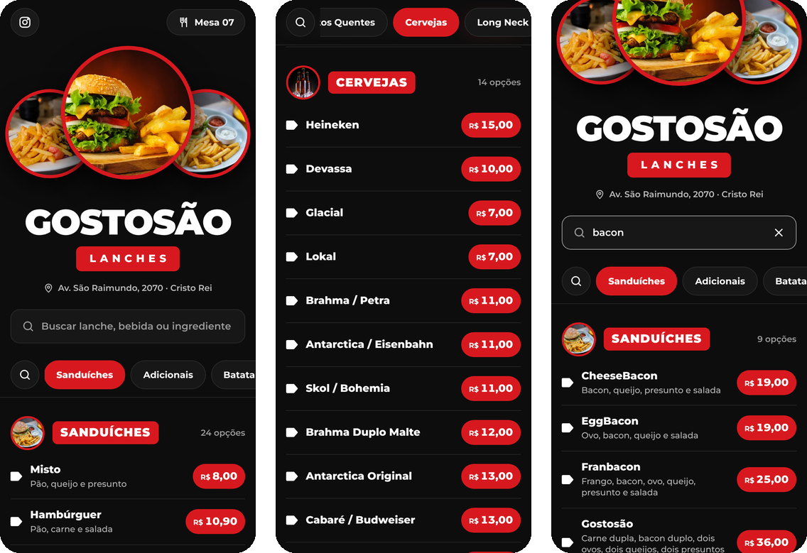
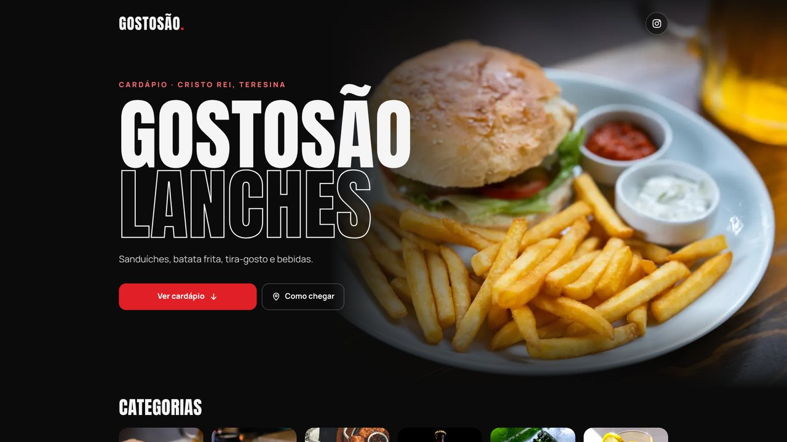
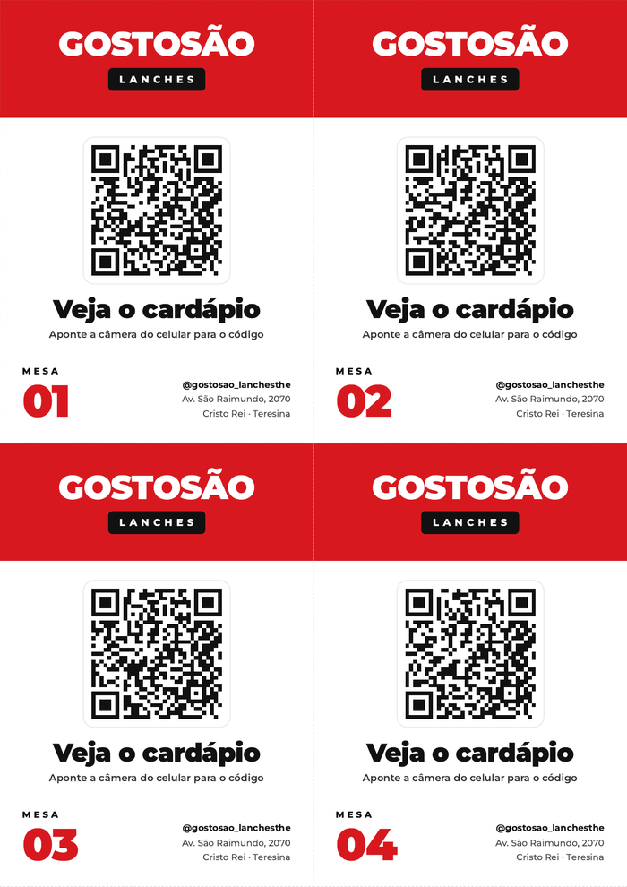

# Cardápio digital · Gostosão Lanches

Projeto solo de estudo: testar design de front-end e aprender, de ponta a ponta, como um site sai do papel e chega no ar.

A ideia veio de uma lanchonete aqui perto, o Gostosão Lanches, em Teresina. O cardápio deles só existia impresso, então virou um site simples: um QR code nas mesas abre o cardápio pra consultar os preços. É estudo, mas com cliente de verdade.

<p align="center">
  
</p>

<p align="center">
  
</p>

## O que estou praticando

- **Design responsivo:** uma hero page imersiva, com foto de ponta a ponta, tipografia condensada (Anton) e o preto e vermelho da marca; carrossel de categorias com foto e lista com o pontilhado clássico de cardápio. No computador, a foto vai pra metade direita, as categorias viram uma coluna lateral e a lista ganha duas colunas.
- **Next.js, TypeScript e Tailwind:** App Router, componentes de servidor e de cliente, site exportado como estático.
- **Experiência de cardápio:** busca sem acento, abas de categoria que acompanham a rolagem e o lanche da casa em destaque.
- **O caminho até produção:** testes, CI no GitHub Actions, deploy automático, SEO e acessibilidade.

## Pra rodar

Precisa do Node.js 22.12 ou mais novo.

```bash
npm install
npm run dev     # http://localhost:3000
npm run check   # lint, tipos e testes
```

O `npm run dev` só aceita conexões do próprio computador. Para abrir no celular pela rede, rode `npx next dev -H 0.0.0.0` só numa rede em que você confia e feche quando terminar: as rotas internas do servidor de desenvolvimento não pedem senha.

## Onde mexer

- O cardápio inteiro fica em `src/data/menu.ts`. Os preços estão em centavos: R$ 18,00 vira `1800`.
- Endereço e Instagram ficam em `src/config/site.ts`.
- O cartão com o QR code pra imprimir fica em `/qrcodes`. É o mesmo código pra todas as mesas:

<p align="center">
  
</p>

## Anotações do caminho

- Preço em centavos evita erro de arredondamento.
- O QR code guarda só o endereço: dá pra mudar o cardápio à vontade sem reimprimir nada, mas trocar de domínio quebra os cartões.
- O plano grátis da Vercel não permite uso comercial; pra lanchonete usar de verdade, a hospedagem precisa mudar.

## Próximos passos

- [ ] Horário de funcionamento e WhatsApp
- [ ] Fotos reais dos lanches
- [ ] Pedido local ou delivery
- [ ] Painel pra atualizar preços

## Stack

Next.js 16 · React 19 · TypeScript · Tailwind CSS 4 · Vitest · GitHub Actions · Vercel

---

Cardápio, marca e fotos são do Gostosão Lanches. O código está sob a [licença MIT](LICENSE).
